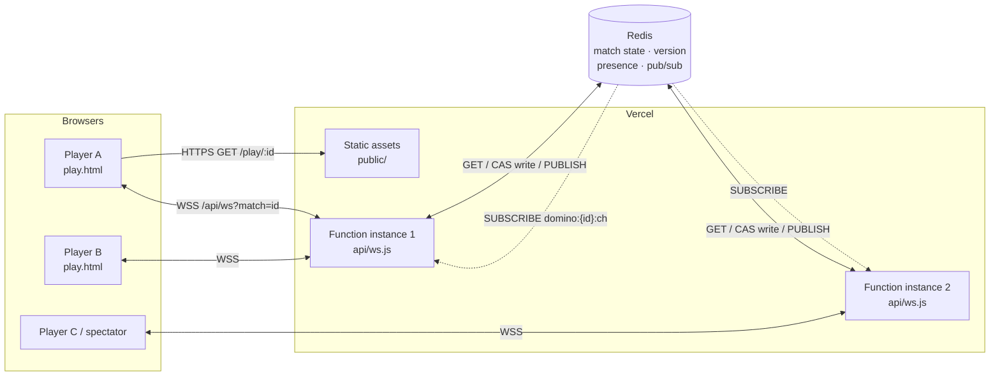
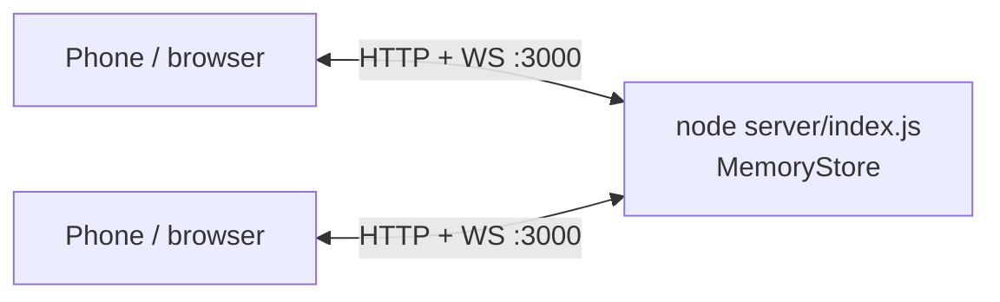
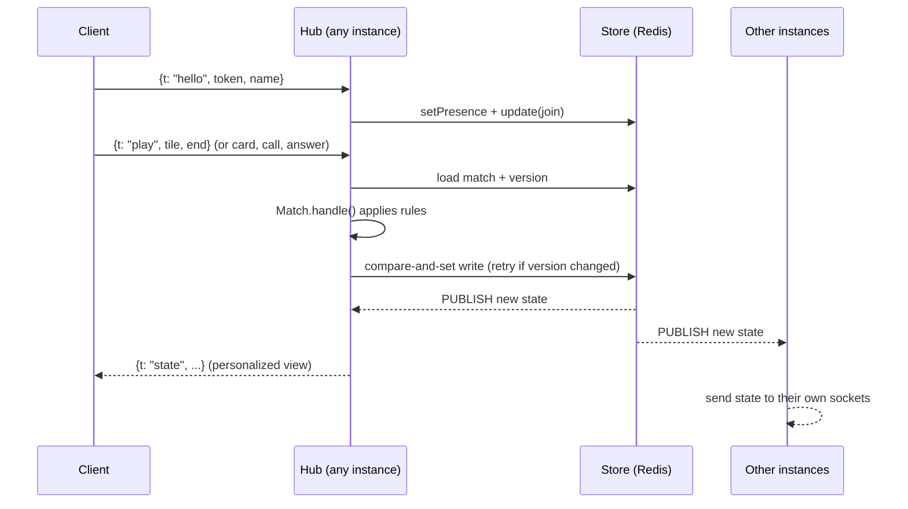

# La Mesa

Mobile-first, four-player games (2 vs 2) you play in the browser: partner dominoes, Venezuelan truco with vira, perico and perica, Venezuelan caída, parchís in pairs, and roba la cochina. There's no login: create a match, pick the game in the lobby, share the `/play/<match-id>` link, and fill any empty seats with bots.

Created in [T3 Code](https://t3.codes).

## Features

- **Five games, one link.** Anyone in the lobby can switch between dominoes, truco, caída, parchís and roba la cochina, and everyone there sees the change. The target options follow the game. Once the game starts it stays until you go back to the lobby.
- **No accounts.** Each browser gets a random token in `localStorage`, and your name is saved there for future matches.
- **Player photos.** Take a picture or choose a file on the home page or in the lobby and it becomes your avatar. A picture taken here never reaches the device's gallery. It is saved only in your browser's `localStorage`; the server passes it to the others in the match and never stores it.
- **Shareable matches.** A match lives at `/play/<id>`. The invite button uses the native share sheet when the browser has one, and links unfurl with a preview image in WhatsApp and other chat apps. The preview is the same for every game: chat apps only see the static page, and the game can still change until the match starts. The share sheet's text names the current game.
- **Bots.** Fill empty seats from the lobby with Venezuelan memes, drawn at random each time. Mid-game, a spectator can take over a bot's seat and hand, and a player who disconnected can be replaced by a bot so the game keeps going. Bots only see their own tiles or cards and the table.
- **Spectators.** Anyone who opens the link after the seats are taken watches the game.
- **Reconnects.** Reloading or briefly losing the connection puts you back in your seat with your hand. Sockets are replaced before the host's time limit ends them, so games and voice calls carry on without a drop. The client notices dead connections within seconds, reconnects with backoff, and retries right away when the network or the tab comes back. If you were swapped for a bot while away, rejoining gives you your seat back.
- **Voice chat.** Everyone in a match (players and spectators) can join the room's voice chat with the mic button, from the lobby or the table, mute themselves, or hang up. Audio goes peer to peer over WebRTC; the server only relays the connection setup. Seated players in voice get a mic badge on their avatar and a green ring while they talk. Without a microphone (blocked, missing, or a plain-`http` LAN page) you join as a listener.
- **Reactions and sound.** Emoji reactions shown at the table (👏 😂 😮 😡 🔥 👋), sound effects, and a pass animation. When players send the same emoji within 3 seconds, a big one pops over the table.
- **Your hand, your order.** Drag a tile or card to a new slot in your hand at any point.
- **Rules at the table.** The book icon, in the lobby and at the table, opens the rules of the game being played.
- **English and Spanish.** The language follows the browser, and the EN/ES button switches it (saved in `localStorage`). Truco's calls (¡Truco!, Quiero…) and caída's (¡Caída!, ¡Ronda!…) stay in Spanish in both.
- **Traditional suits.** The oros, copas, espadas and bastos use public-domain drawings of the Spanish deck by [Florixc on Wikimedia Commons](https://commons.wikimedia.org/wiki/File:Seme_denari_carte_spagnole.svg), lightly cleaned up in `public/suits/`.
- **Installable.** Ships a web app manifest, so it can be added to the home screen.
- **Admin page.** `/admin`, behind one shared password, shows who is in voice, TURN usage as reported by Metered, voice joins, game socket traffic, and the state of Redis and TURN.

### Domino rules

- Double-six set with 7 tiles per player and no boneyard. Seats 0 and 2 play against seats 1 and 3, and turns go 0 → 1 → 2 → 3.
- In the first round, whoever holds the double six must open with it. After that, the opener rotates: the player to the right of the last round's opener opens with any tile, whoever won.
- If you have no legal move, the game passes for you automatically after 3 seconds.
- On your turn you can try any tile, even when none of them fit. Dropping one anywhere on the table where it can't go is not played, and the table mocks you for it: everyone else hears a laugh and sees a 🤡 over your seat.
- **Domino:** the player who empties their hand wins for their team. The team scores the pips left in the losing team's hands.
- **Blocked game:** the team with fewer pips wins and scores the losing team's pips. A tie scores nothing.
- The match ends when a team reaches the target score, which you set in the lobby to 50, 75 or 100.

### Truco rules

Truco has many house rules, and written sources disagree on some details. This is what the game implements.

**Deal.** A 40-card Spanish deck (no 8s or 9s). Everyone gets 3 cards and one more is turned up as the **vira**. Seats 0 and 2 play against seats 1 and 3, and turns go 0 → 1 → 2 → 3 (counter-clockwise). The **mano** leads the first trick, wins ties, and moves one seat each hand.

**Cards, best to worst:**

1. **Perico:** the 11 of the vira's suit
2. **Perica:** the 10 of the vira's suit
3. 1 of espadas, 1 of bastos, 7 of espadas, 7 of oros
4. The 3s, the 2s, then the 1s of copas and oros
5. The 12s, 11s and 10s, then the 7s of copas and bastos
6. The 6s, 5s and 4s

If the vira is itself the 11 or the 10, the **12 of that suit** takes its place as perico or perica.

**Tricks.** The team that takes two of three tricks wins the hand. A tied trick (*parda*) is led again by whoever led it:

- First trick tied: the second trick decides.
- One team won the first trick and a later trick ties: that team wins.
- All three tied: the mano's team wins.

**Truco.** A hand is worth 1. On your turn you can raise it, and the other team answers *quiero*, *no quiero*, or raises straight back. After a raise is accepted, only the team that accepted it can raise next.

| Call | If accepted | If refused |
| --- | --- | --- |
| Truco | 3 | 1 |
| Retruco | 6 | 3 |
| Vale nueve | 9 | 6 |
| Vale juego | the match | 9 |

On your turn you can also go **al mazo**: your team folds and the other team scores the hand's current value.

**Envido.** Called before your first card, on your turn or in reply to a truco (the truco then waits for the envido to be settled). It's worth 2. The other team can accept, refuse, or raise with *y envido* (+2), *cinco más* (+5) or *falta envido* (what the leading team needs to reach the target). A first envido refused pays 1, and a refused raise pays what had been bet before it.

Hand values: perico 30 and perica 29, plus the best other card. Otherwise, two cards of a suit are 20 plus their numbers (10, 11 and 12 count 0), or the highest single card if no suit repeats. The highest value on either team wins, and ties go to the seat closest to the mano.

**Flor.** Three cards of a suit, or the perico or perica with two cards of a suit. You sing it before your first card, on your turn or when answering a bet, and it's worth 3. Singing a flor cancels the envido. If you play your first card without singing it, the flor is lost and the table laughs at you. If both teams sing, the higher flor scores (20 plus the numbers, or the piece plus the numbers).

**Flor reservada.** Perico and perica in the same hand is worth 5 and doesn't need to be sung.

**Scoring.** Points are added when the hand ends: flor, then envido, then truco. Nothing more is added once a team reaches the target, which you set in the lobby to 12, 24 or 32.

**Not implemented:** *con flor envido* and *contraflor* (the bets between two flores), *a ley*, *privar*, burning a card face-down, and partner signals (*señas*). A team scores one flor per hand even if both partners hold one.

Rules are based on [Wikipedia ES](https://es.wikipedia.org/wiki/Truco_venezolano), [Ludoteka](https://www.ludoteka.com/games/truco-venezolano/rules) and [Conecta Games](https://conectagamesblog.wordpress.com/2015/12/18/reglas-del-truco-venezolano/).

### Caída rules

Caída changes from table to table, and we found no authoritative rulebook. This follows a [write-up of its close relative Ronda](https://www.steemit.com/powerhousecreatives/@hlezama/the-blackouts-made-us-rediscover-the-game-of-ronda) and the [Caída app listings](https://apps.apple.com/us/app/caida/id6749165111). The values that vary most are constants at the top of `server/games/caida.js`.

- 40-card Spanish deck, 2 vs 2. A round is the table, then three deals of 3 cards each, which uses the whole deck.
- **The table.** The dealer calls the count, 1 → 4 or 4 → 1, and lays 4 cards. A card on its own number scores that number. Four different numbers first try gives the dealer +1. A repeated number goes back in the deck and gives the other team +1 instead.
- **Cantos.** Sung on your turn, before your first card of each deal. Ronda (a pair) pays 1 for 1 to 7, 2 for 10s, 3 for 11s, 4 for 12s. Patrulla (three in a row) pays 2. Tolete (three of a kind) pays 3. Once everyone has played from the deal, the best kind pays, and if both teams sang the same kind both score.
- **Captures.** A card takes the same number from the table and any cards that follow it in sequence, automatically. With no match it stays on the table.
- **Caída.** Taking the card the player before you just played pays 1 for 1 to 7, 2 for a 10, 3 for an 11, 4 for a 12.
- **Mesa limpia.** Taking every card on the table pays 4, on top of any caída.
- **End of the round.** The last team to capture takes what's left, and the team with more cards scores 1 for each card above 20.
- **Winning.** Points land as they happen, and the first team to the target (12 or 24) wins on the spot.

**Not implemented:** other cantos such as registro or vigía, bluffing a canto, and *soplada* (there is nothing to claim, because captures are automatic). It's 4 players in teams only.

### Parchís rules

Parchís in pairs on 68 squares, with one die or two, picked in the lobby. One die follows the classic Spanish rules in [Wikipedia ES](https://es.wikipedia.org/wiki/Parch%C3%ADs). Two dice follows the Superparchís rules at [Mundijuegos Venezuela](https://www.mundijuegos.com.ve/multijugador/parchis/reglas/) and is the default. We found no rulebook specific to Venezuela. Tables differ on several details, and the values that vary most are constants at the top of `server/games/parchis.js`.

- 2 vs 2, partners across: yellow with red, blue with green. Your nest is always drawn at the bottom left.
- **The route.** 63 squares from your start to your entry, then 7 of your own corridor, then the goal, which needs the exact count.
- **The die.** A 5 has to bring a piece out if one can come out. A 6 rolls again, and moves 7 with nothing in your nest. A third 6 in a row ends the turn and sends the last piece moved to its nest, unless it's in its corridor.
- **Two dice.** Each die is used separately, on one piece or two, in the order you pick. Dice adding up to 5 bring a piece out between them, and a double 5 brings out two. A double rolls again, a third double in a row is punished like a third 6, and a 6 is just a 6. A double has to open your barrier if it can, which we carried over from the 6.
- **Captures.** Landing on a lone rival sends it home and pays 20, counted with one piece. Safe squares and start squares protect, and partners never take each other. Coming out onto a full start square takes the rival that got there last.
- **Barriers.** Two pieces of one color stop everyone, their owner included, and a 6 has to open yours if it can. A square holds two pieces at most.
- **The goal.** Reaching it pays 10. A bonus no piece can use is lost. With your four pieces home, your rolls move your partner's.
- **Winning.** The first pair with all eight pieces home wins the game, and you pick 1, 2 or 3 games in the lobby.

**House rules that differ from that article:** barriers stop everyone on any square (it only applies that to start squares), a 5 always has to come out, and taking a piece as you come out also pays 20. It's 4 players in teams only.

### Roba la cochina rules

Roba la cochina (also *roba montón*, *steal the pile*) is a children's capture game played all over Latin America, with a different rule at every table. This is a common version adapted to teams. The timings and the targets are at the top of `server/games/cochina.js`.

- 40-card Spanish deck, 2 vs 2. Partners share one pile, the **cochina**, kept face up so its top card shows.
- **The deal.** 4 cards face up on the table, then three deals of 3 cards each, which uses the whole deck. The player after the dealer starts, and the dealer rotates each round.
- **Playing.** Play one card; only its number counts. It takes every card of that number from the table onto your cochina, with your card on top. With no match it stays on the table.
- **Stealing.** If your card matches the top card of the other team's cochina, their whole pile goes onto yours. It can take from the table at the same time. Captures are automatic.
- **End of the round.** The last capture takes what's left on the table, slipped under the cochina. The team with more cards wins the round and scores 1, and equal cochinas score nothing.
- **Winning.** First team to win 1, 3 or 5 rounds, picked in the lobby.

**Not implemented:** stacking a card onto your own cochina when it matches your top card, and individual piles for 2 or 3 players.

## Stack

| Layer    | Tech |
| -------- | ---- |
| Client   | Plain HTML, CSS and ES modules in `public/`, with no framework or build step. Tiles are drawn with DOM and CSS, cards are SVG built in the browser from the suit drawings, and sound uses the Web Audio API. |
| Server   | Node.js (≥ 18, ESM) using `node:http` and [`ws`](https://github.com/websockets/ws) for WebSockets |
| State    | In-memory store for local dev. [Redis](https://redis.io) (`redis` v5 client) when several instances need to share matches. |
| Hosting  | [Vercel](https://vercel.com): static files from `public/` plus one Vercel Function (`api/ws.js`) that accepts WebSocket upgrades |
| Tests    | Built-in `node:test` runner |

The project has two runtime dependencies, `ws` and `redis`.

## Project layout

```
api/ws.js          Vercel Function: the WebSocket endpoint (/api/ws?match=<id>)
api/admin.js       Vercel Function: admin data (/api/admin)
server/
  index.js         Local entry point (HTTP + static files + WebSocket on one port)
  app.js           Shared HTTP/WebSocket server: upgrade handling, heartbeats
  hub.js           Connects sockets to matches, fans out state, schedules automatic moves, relays voice signaling and photos
  store.js         MemoryStore (local) and RedisStore (shared): storage, presence, pub/sub
  usage.js         Buffers usage counters and writes them in batches
  admin.js         Password check and the report behind the admin page
  metered.js       TURN usage from Metered's API
  match.js         A match as serializable state: game, seats, lobby, reactions, per-player views
  games/
    index.js       The list of games, and what a game has to provide
    common.js      Seats and teams, shuffling, MoveError, bot pacing, the catchphrase odds
    domino.js      Pure domino rules and bot AI, plus the `game` object
    truco.js       Pure truco rules and bot AI, plus the `game` object
    caida.js       Pure caída rules and bot AI, plus the `game` object
    parchis.js     Pure parchís rules and bot AI, plus the `game` object
    cochina.js     Pure roba la cochina rules and bot AI, plus the `game` object
public/
  index.html       Landing page (new match / join by code)
  play.html        Game table
  admin.html       Admin page
  js/play.js       Client shell: connection, lobby, seats, voice, photos, reactions, drag, result frame
  js/domino.js     Domino table: board, hand, drop targets, how a round reads
  js/truco.js      Truco table: vira, trick, call buttons, how a hand reads
  js/caida.js      Caída table: loose cards, the dealer's count, captures, how a round reads
  js/parchis.js    Parchís table: the board, hopping pieces, the die, how a game reads
  js/cochina.js    Roba la cochina table: loose cards, both cochinas, steals, how a round reads
  js/rules.js      The full rules of each game, for the rules sheet
  js/flight.js     Throwing a tile or card from a seat to the table
  js/board.js      Lays out the line of tiles on the table
  js/tiles.js      Tile markup
  js/cards.js      Card markup (SVG, placing the suit drawings)
  suits/           Traditional suit drawings (public domain)
  sounds/          El Manguangua's catchphrase
  js/fx.js         Win and lose animations
  js/sound.js      Sound effects
  js/voice.js      Voice chat (WebRTC mesh, signaling over the game socket)
  js/avatar.js     Player photos: camera, file picker, local storage
  js/i18n.js       UI strings (English, Spanish), shared and per game, and language switching
  js/admin.js      Admin page: sign-in and usage
  css/style.css    Styles
test/              Rules of both games, match, board layout, game choice, voice relay and admin tests
vercel.json        Rewrites /play/:id → /play.html and /admin → /admin.html
```

## Architecture

### How a game plugs in

A match's `game` field picks its rules. `Match` handles what is common (seats, bots joining, reactions, the lobby, the target) and calls the game's `game` object for the rest. The fields are listed in `server/games/index.js`: `targets`, `defaultTarget`, `newRound`, `handle`, `settle`, `pendingAuto`, `runAuto` and `roundView`.

On the client, `play.js` keeps one view per game (`domino.js`, `truco.js`, `caida.js`, `parchis.js`, `cochina.js`) and calls the current one for the table, the hand, the status line and the details of the result. `i18n.js` looks in the current game's strings before the shared ones, and CSS rules that share a name between games are scoped with `body[data-game]`.

The `domino:` prefix on Redis keys and the `domino.*` browser storage keys predate truco and cover every game. Renaming them would lose live matches, the usage counters, and players' names, seats and photos. Matches saved without a `game` load as dominoes.

### Connection diagram



In local dev, a single Node process serves the static files and the WebSocket and keeps everything in memory, so Redis isn't needed:



### How a move flows



Key points:

- **Instances hold no state.** Each server instance keeps only its own sockets. The match itself is a plain JSON object in the store, and any instance can load it, apply a change, and save it.
- **Optimistic concurrency.** `RedisStore.update` writes with a Lua compare-and-set on a version key. If another instance saved first, it reloads and re-applies the change (up to 8 attempts).
- **Fan-out.** Every saved change is published on `domino:{id}:ch`. Each instance subscribed to that match sends every connected player a personalized view (`Match.stateFor`), so you only see your own hand until the round ends.
- **Bots and forced passes.** Every instance with players in the match schedules the automatic move, keyed by turn (`round:lineLength:seat:lastAction`). Only the first one to run gets applied, so duplicates are harmless.
- **Presence.** Each connection refreshes a presence entry every 15 s (expires after 40 s). When a socket closes, the player keeps a 20 s grace period so a reload or a network blip doesn't show them as offline (or free their seat). Lobby seats held by players who have gone offline are freed.
- **Heartbeats.** The server pings sockets every 25 s and drops ones that neither answered nor sent anything. The client sends an app-level `ping` every 10 s, plus one right after each action. If no reply arrives within 25 s (6 s after an action), it treats the socket as half-open, drops it and reconnects.
- **Socket handover.** A Vercel Function, and every socket it holds, ends at its max duration (300 s by default). About 4 minutes into a socket's life (with jitter), the client opens a second socket and sends `hello` with the same `session`. When `voiceConfig` arrives on the new socket, the client switches to it, sends `handoff` on the old one and closes it. The server skips the voice `bye` and the presence grace period for a socket that sent `handoff`. If the old socket dies first, the client falls back to a normal reconnect.
- **Voice chat.** A full mesh of WebRTC audio connections between everyone in voice. Signaling goes over the game socket and, between instances, through `domino:{id}:sig` (pub/sub only, nothing stored). Each client gets a public peer id, a hash of its token and `session`, so tokens never reach other clients. Every normal connect uses a new `session`; a handover reuses it, which keeps the id and leaves the audio connections untouched. A newcomer broadcasts `join`, members answer `hello`, and in each pair only the peer with the smaller id sends offers, so they never collide. When a socket closes the server broadcasts `bye`; after a reconnect the client re-joins with its new peer id.
- **Usage tracking.** Audio never reaches the server, so TURN data comes only from Metered's usage API (cached for a minute). The hub tracks who is in voice from the signaling it relays, and counts voice joins and game socket traffic. Each instance writes its counters every 30 s and after its last socket closes.
- **Expiry.** Redis keys expire after a day without activity. Daily usage counters last 100 days, and the all-time totals don't expire.

### WebSocket protocol

All messages are JSON with a `t` field. Messages are limited to 16 KB (voice signaling to 12 KB).

| Client → server | Payload | When |
| --- | --- | --- |
| `hello` | `token`, `name`, `session?`, `inVoice?`, `games?`, `game?` | First message. Joins the match and takes a free seat if in the lobby. `session` determines the voice peer id. `inVoice` says a handover or reconnect is already in voice. `games` lists the games this page can draw. A tab from an older deploy sends `true` (domino and truco) or nothing (domino), and is asked to reload instead of receiving a state it can't draw. `game` picks the game if the match is brand new, from a `?game=` link. |
| `handoff` | | The client is moving to another socket and is about to close this one |
| `rename` | `name` | Any time |
| `sit` / `stand` | `seat` | Lobby. `sit` also lets a spectator take over a bot mid-game. |
| `addBots` / `removeBot` | `seat` | Lobby |
| `game` | `game: "domino" \| "truco" \| "caida" \| "parchis" \| "cochina"` | Lobby. Resets the target to the game's default. |
| `target` | `50 \| 75 \| 100`, `12 \| 24 \| 32`, `12 \| 24`, `1 \| 2 \| 3` or `1 \| 3 \| 5` | Lobby, from the current game's list |
| `variant` | `1 \| 2` | Lobby, a game that offers a choice: parchís's dice |
| `start` | | Lobby, once all 4 seats are filled |
| `play` | Domino: `tile: [a, b]`, `end: "L" \| "R"`. Truco, caída and roba la cochina: `card: [number, suit]` | On your turn |
| `call` | `what: "flor" \| "envido" \| "cinco" \| "falta" \| "truco" \| "mazo"` | Truco, when the `options` in your state allow it |
| `answer` | `yes: boolean` | Truco, a bet is open against your team |
| `call` | `what: "canto"` | Caída, when `options.canto` is set |
| `order` | `dir: 1 \| -1` | Caída, you are dealing and the table is not laid yet |
| `roll` | | Parchís, when `options.roll` is set |
| `move` | `color`, `piece`, `steps?` | Parchís, one of `options.moves`. `steps` picks which die or bonus to use. |
| `next` / `rematch` / `lobby` | | After a round or match ends |
| `botify` | `seat` | Replace a disconnected player with a bot |
| `react` | `emoji` | Seated players (600 ms cooldown) |
| `blunder` | | You tried an illegal move or forgot your flor, so the others can mock you (2 s cooldown) |
| `voice` | `to?` (peer id), `data` | Voice chat signaling, relayed to one peer or everyone else in the match (rate limited) |
| `avatar` | `image` (JPEG data URL or `null`), `to?` (peer id), `ask?` | Your photo, relayed to one peer or everyone else in the match and never stored (rate limited). `ask` means "send me yours". |
| `ping` | | Keep-alive. The server replies `pong`. |

| Server → client | Payload |
| --- | --- |
| `state` | Full personalized view: game, targets, phase, seats, scores, history, the round (board line and legal moves, or vira, tricks, open bets and `options`) and your hand |
| `error` | `message` (illegal move) |
| `voiceConfig` | `peer` (this connection's public voice id), `iceServers`. Sent after `hello`. |
| `voice` | `from` (peer id), `data`: relayed voice signaling. `data.kind: "bye"` means that connection closed. |
| `avatar` | `from` (the seat's `pid`), `peer`, `image`, `ask`: another player's photo. Answer `ask` by sending yours `to` that `peer`. |
| `pong` | |

## Running locally

```sh
npm install
npm run dev      # node --watch, restarts on changes
# or
npm start
```

Open http://localhost:3000. On startup the server also prints a LAN address so phones on the same Wi-Fi can join.

| Env var | Default | Purpose |
| --- | --- | --- |
| `PORT` | `3000` | HTTP/WebSocket port (local server) |
| `REDIS_URL` (or `KV_URL`) | unset | Use Redis instead of memory. Optional locally, required on Vercel. |
| `ICE_SERVERS` | Google STUN | JSON array of [`RTCIceServer`](https://developer.mozilla.org/docs/Web/API/RTCIceServer)s for voice chat. Add a TURN server so voice works for players behind strict NATs (common on mobile data). |
| `ADMIN_PASSWORD` | unset | Shared password for `/admin`. The admin data is refused until it's set. |
| `METERED_APP`, `METERED_SECRET_KEY` | unset | Metered app name (`<app>.metered.live`) and secret key. When set, `/admin` shows the TURN usage Metered reports for the billing cycle. |

Health check: `GET /healthz` → `ok` (local server).

### Tests

```sh
npm test
```

## Deployment

The app is deployed on Vercel with no build step:

- `public/` is served as static files.
- `api/ws.js` is a Vercel Function (Node.js runtime, Fluid Compute) that accepts WebSocket upgrades at `/api/ws?match=<id>`.
- `vercel.json` rewrites `/play/:id` to `/play.html`.
- The Open Graph tags in `public/index.html` and `public/play.html` point at the production domain, because chat apps need an absolute image URL. Update them if the domain changes.

### Steps

1. **Import the repo** into Vercel, or run `vercel link` from the project directory. No framework preset or build command is needed.
2. **Add Redis.** Connect a Redis database from the Vercel Marketplace (for example Upstash Redis), or use any Redis you already have, and make sure `REDIS_URL` is set for Production and Preview:
   ```sh
   vercel env add REDIS_URL
   ```
   Without it, each function instance keeps its own in-memory matches, so players who land on different instances won't see each other. A warning is logged in that case.
3. **Deploy:**
   ```sh
   vercel          # preview
   vercel --prod   # production
   ```

Pushes to `main` deploy to production automatically when the project is connected to Git.

### Self-hosting

Any host that runs a long-lived Node process works: `npm start` serves everything on `PORT`. If you run more than one instance behind a load balancer, set `REDIS_URL` so they share matches. The load balancer must support WebSocket upgrades.

## Roadmap

Ideas tracked in [`features.md`](features.md).
