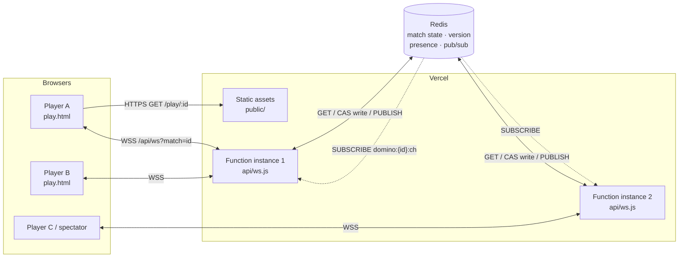
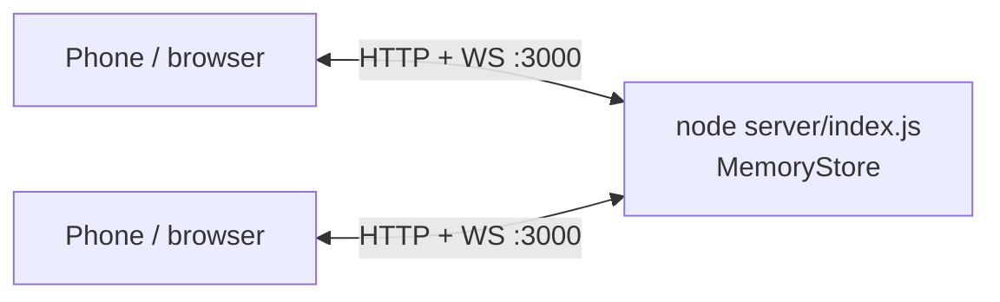
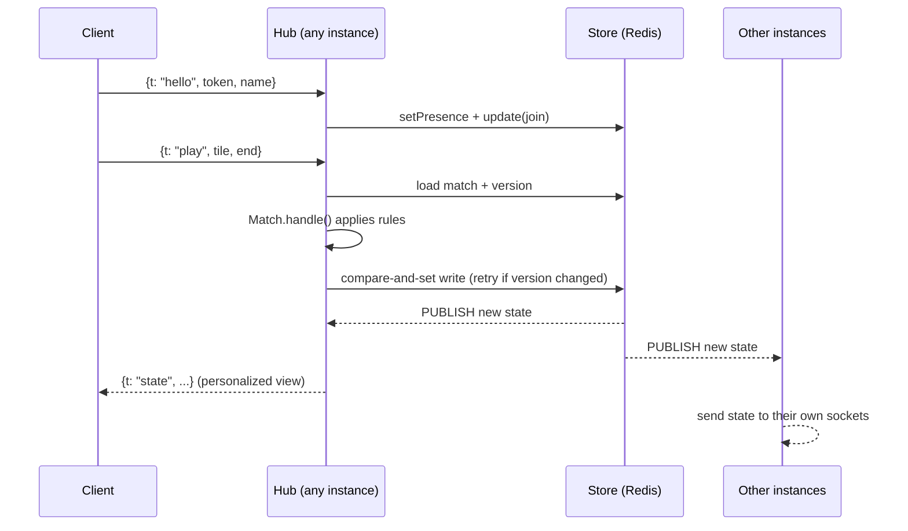

# Domino

Mobile-first, four-player partner dominoes (2 vs 2) you play in the browser. There's no login: create a match, share the `/play/<match-id>` link, and fill any empty seats with bots.

Created in [T3 Code](https://t3.codes).

## Features

- **No accounts.** Each browser gets a random token in `localStorage`, and your name is saved there for future matches.
- **Shareable matches.** A match lives at `/play/<id>`. The invite button uses the native share sheet when the browser has one.
- **Bots.** Fill empty seats from the lobby. Mid-game, a spectator can take over a bot's seat and hand, and a player who disconnected can be replaced by a bot so the game keeps going.
- **Spectators.** Anyone who opens the link after the seats are taken watches the game.
- **Reconnects.** Reloading or briefly losing the connection puts you back in your seat with your hand. The client notices dead connections within seconds, reconnects with backoff, and retries right away when the network or the tab comes back. If you were swapped for a bot while away, rejoining gives you your seat back.
- **Reactions and sound.** Emoji reactions shown at the table (👏 😂 😮 😡 🔥 👋), sound effects, and a pass animation.
- **Installable.** Ships a web app manifest, so it can be added to the home screen.

### Rules

- Double-six set with 7 tiles per player and no boneyard. Seats 0 and 2 play against seats 1 and 3, and turns go 0 → 1 → 2 → 3.
- In the first round, whoever holds the double six must open with it. After that, the previous round's winner opens with any tile.
- If you have no legal move, the game passes for you automatically.
- **Domino:** the player who empties their hand wins for their team. The team scores the pips left in all four hands.
- **Blocked game:** the team with fewer pips wins and scores both teams' pips. A tie scores nothing. The next round is opened by the player with the lighter hand on the winning team.
- The match ends when a team reaches the target score, which you set in the lobby to 100, 150 or 200.

## Stack

| Layer    | Tech |
| -------- | ---- |
| Client   | Plain HTML, CSS and ES modules in `public/`, with no framework or build step. Tiles are drawn with DOM and CSS, and sound uses the Web Audio API. |
| Server   | Node.js (≥ 18, ESM) using `node:http` and [`ws`](https://github.com/websockets/ws) for WebSockets |
| State    | In-memory store for local dev. [Redis](https://redis.io) (`redis` v5 client) when several instances need to share matches. |
| Hosting  | [Vercel](https://vercel.com): static files from `public/` plus one Vercel Function (`api/ws.js`) that accepts WebSocket upgrades |
| Tests    | Built-in `node:test` runner |

The project has two runtime dependencies, `ws` and `redis`.

## Project layout

```
api/ws.js          Vercel Function: the WebSocket endpoint (/api/ws?match=<id>)
server/
  index.js         Local entry point (HTTP + static files + WebSocket on one port)
  app.js           Shared HTTP/WebSocket server: upgrade handling, heartbeats
  hub.js           Connects sockets to matches, fans out state, schedules bots/auto-passes
  store.js         MemoryStore (local) and RedisStore (shared): storage, presence, pub/sub
  match.js         A match as serializable state: seats, lobby, scoring, per-player views
  game.js          Pure round logic: dealing, legal moves, playing, passing, scoring, bot AI
public/
  index.html       Landing page (new match / join by code)
  play.html        Game table
  js/play.js       Client: WebSocket connection, rendering, input
  js/board.js      Lays out the line of tiles on the table
  js/tiles.js      Tile markup
  js/fx.js         Animations and reactions
  js/sound.js      Sound effects
  css/style.css    Styles
test/              Game and board layout tests
vercel.json        Rewrites /play/:id → /play.html
```

## Architecture

### Connection diagram



In local dev, a single Node process serves the static files and the WebSocket and keeps everything in memory, so Redis isn't needed:



### How a move flows



Key points:

- **Instances hold no state.** Each server instance keeps only its own sockets. The match itself is a plain JSON object in the store, and any instance can load it, apply a change, and save it.
- **Optimistic concurrency.** `RedisStore.update` writes with a Lua compare-and-set on a version key. If another instance saved first, it reloads and re-applies the change (up to 8 attempts).
- **Fan-out.** Every saved change is published on `domino:{id}:ch`. Each instance subscribed to that match sends every connected player a personalized view (`Match.stateFor`), so you only see your own hand until the round ends.
- **Bots and forced passes.** Every instance with players in the match schedules the automatic move, keyed by turn (`round:lineLength:seat:lastAction`). Only the first one to run gets applied, so duplicates are harmless.
- **Presence.** Each connection refreshes a presence entry every 15 s (expires after 40 s). When a socket closes, the player keeps a 20 s grace period so a reload or a network blip doesn't show them as offline (or free their seat). Lobby seats held by players who have gone offline are freed.
- **Heartbeats.** The server pings sockets every 25 s and drops ones that neither answered nor sent anything. The client sends an app-level `ping` every 10 s, plus one right after each action. If no reply arrives within 25 s (6 s after an action), it treats the socket as half-open, drops it and reconnects.
- **Expiry.** Redis keys expire after a day without activity.

### WebSocket protocol

All messages are JSON with a `t` field. Messages are limited to 4 KB.

| Client → server | Payload | When |
| --- | --- | --- |
| `hello` | `token`, `name` | First message. Joins the match and takes a free seat if in the lobby. |
| `rename` | `name` | Any time |
| `sit` / `stand` | `seat` | Lobby. `sit` also lets a spectator take over a bot mid-game. |
| `addBots` / `removeBot` | `seat` | Lobby |
| `target` | `100 \| 150 \| 200` | Lobby |
| `start` | | Lobby, once all 4 seats are filled |
| `play` | `tile: [a, b]`, `end: "L" \| "R"` | On your turn |
| `next` / `rematch` / `lobby` | | After a round or match ends |
| `botify` | `seat` | Replace a disconnected player with a bot |
| `react` | `emoji` | Seated players (600 ms cooldown) |
| `ping` | | Keep-alive. The server replies `pong`. |

| Server → client | Payload |
| --- | --- |
| `state` | Full personalized view: phase, seats, scores, history, board line, your hand and legal moves |
| `error` | `message` (illegal move) |
| `pong` | |

## Running locally

```sh
npm install
npm run dev      # node --watch, restarts on changes
# or
npm start
```

Open http://localhost:3000. On startup the server also prints a LAN address so phones on the same Wi-Fi can join.

| Env var | Default | Purpose |
| --- | --- | --- |
| `PORT` | `3000` | HTTP/WebSocket port (local server) |
| `REDIS_URL` (or `KV_URL`) | unset | Use Redis instead of memory. Optional locally, required on Vercel. |

Health check: `GET /healthz` → `ok` (local server).

### Tests

```sh
npm test
```

## Deployment

The app is deployed on Vercel with no build step:

- `public/` is served as static files.
- `api/ws.js` is a Vercel Function (Node.js runtime, Fluid Compute) that accepts WebSocket upgrades at `/api/ws?match=<id>`.
- `vercel.json` rewrites `/play/:id` to `/play.html`.

### Steps

1. **Import the repo** into Vercel, or run `vercel link` from the project directory. No framework preset or build command is needed.
2. **Add Redis.** Connect a Redis database from the Vercel Marketplace (for example Upstash Redis), or use any Redis you already have, and make sure `REDIS_URL` is set for Production and Preview:
   ```sh
   vercel env add REDIS_URL
   ```
   Without it, each function instance keeps its own in-memory matches, so players who land on different instances won't see each other. A warning is logged in that case.
3. **Deploy:**
   ```sh
   vercel          # preview
   vercel --prod   # production
   ```

Pushes to `main` deploy to production automatically when the project is connected to Git.

### Self-hosting

Any host that runs a long-lived Node process works: `npm start` serves everything on `PORT`. If you run more than one instance behind a load balancer, set `REDIS_URL` so they share matches. The load balancer must support WebSocket upgrades.

## Roadmap

Ideas tracked in [`features.md`](features.md).
