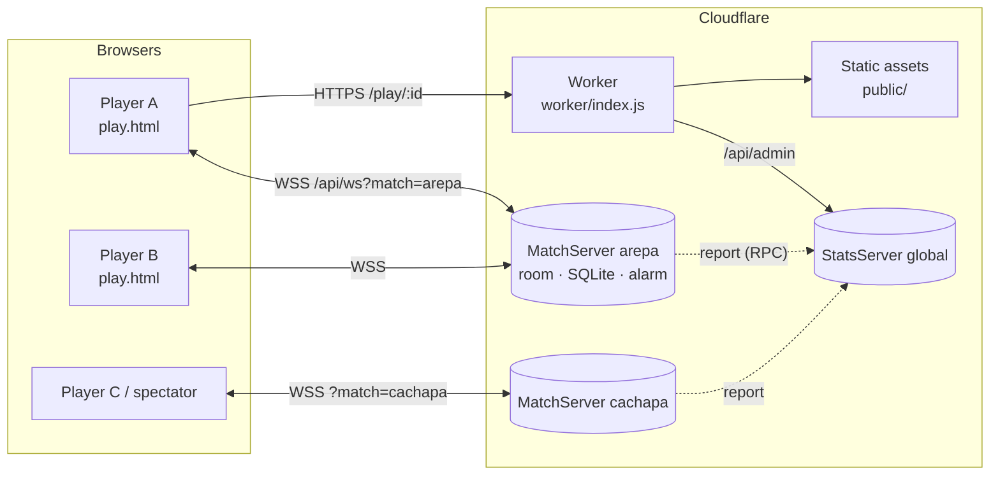
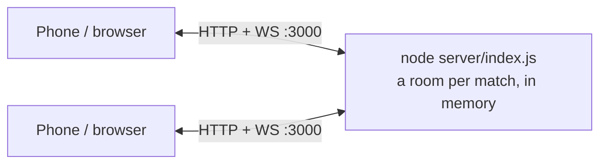
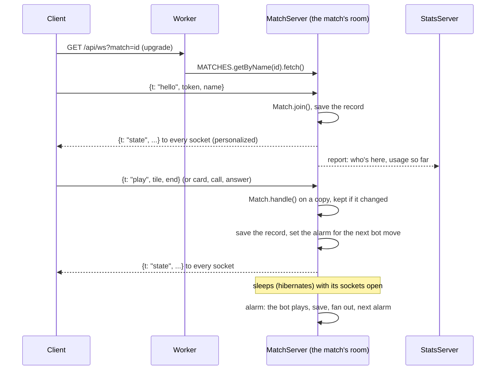

# La Mesa

Mobile-first, four-player games (2 vs 2) you play in the browser: partner dominoes, Venezuelan truco with vira, perico and perica, Venezuelan caída, parchís in pairs, roba la cochina, and partnership rummy. There's no login: create a match, pick the game in the lobby, share the `/play/<match-id>` link, and fill any empty seats with bots.

Created in [T3 Code](https://t3.codes).

## Features

- **Six games, one link.** The lobby shows the game being played. Tap it for the menu of every game, where anyone in the lobby can switch between dominoes, truco, caída, parchís, roba la cochina and rummy, and everyone there sees the change. The target options follow the game. Once the game starts it stays until the match ends: then *Back to the lobby* lets you pick another game or change seats, and *Rematch* plays the same game again. A player can also go back to the lobby mid-game, from the ⋯ menu or a round's result, after confirming: it ends the game for all four and resets the score.
- **Table styles.** Anyone can pick how the table looks for everyone in the match, from *Table style* in the ⋯ menu, in the lobby or at the table: Felt (the green table), Pencil (graphite on graph paper, with hatched card backs and colored-pencil teams) Neon (dark glass tiles with lit pips and a glowing grid) Minimal (flat white, hairlines, no shadows) Dark (graphite, charcoal tiles with white pips, amber highlights), Halloween (a moonlit purple night with bats and pumpkin tiles) or Christmas (a red table under falling snow, snow-white tiles with red pips and candy-cane card backs). A new match starts in the style its first player saw last. The fonts are served from `public/fonts/` (all SIL Open Font License).
- **Team names.** In the lobby, either partner taps *Your team*, above the game, to name the team (up to 16 characters, or one of a few Venezuelan quick picks). Everyone sees it in the lobby, the score and the round results, and gets a toast when it changes. The name stays with the team when players change seats. Without one, the score says Us / Them.
- **No accounts.** Each browser gets a random token in `localStorage`, and your name is saved there for future matches.
- **Player photos.** Take a picture or choose a file on the home page or in the lobby and it becomes your avatar. A picture taken here never reaches the device's gallery. It is saved only in your browser's `localStorage`; the server passes it to the others in the match and never stores it.
- **Shareable matches.** A match lives at `/play/<id>`. *Invite friends*, in the lobby and the ⋯ menu, uses the native share sheet when the browser has one (and copies the link when it doesn't), and links unfurl with a preview image in WhatsApp and other chat apps. The preview is the same for every game: chat apps only see the static page, and the game can still change until the match starts. The share sheet's text names the current game.
- **Bots.** Fill empty seats from the lobby with Venezuelan memes, drawn at random each time. Mid-game, a spectator can take over a bot's seat and hand, and a player who disconnected can be replaced by a bot so the game keeps going. Bots only see their own tiles or cards and the table.
- **Spectators.** Anyone who opens the link after the seats are taken watches the game.
- **Reconnects.** Reloading or briefly losing the connection puts you back in your seat with your hand. A match's sockets stay open as long as the players do, and the client notices dead connections within seconds, reconnects with backoff, and retries right away when the network or the tab comes back. If you were swapped for a bot while away, rejoining gives you your seat back.
- **Voice chat.** Everyone in a match (players and spectators) can join the room's voice chat with the mic button, from the lobby or the table, mute themselves, or hang up. Audio goes peer to peer over WebRTC; the server only relays the connection setup. Seated players in voice get a mic badge on their avatar. While they talk, a green halo breathes around it (outside the turn ring, so it shows on their turn too), the badge shows sound bars, and their name turns green. Without a microphone (blocked, missing, or a plain-`http` LAN page) you join as a listener. When others are in voice and you aren't, whether you arrive to find it on or someone starts it while you're there, in the lobby or at the table, a dialog shows who is in it and offers to join. *Not now* (or hanging up) holds until voice has been empty for 15 seconds. Everyone sees the mic badge on seated players in voice, even from outside it.
- **Reactions and sound.** Reactions thrown at the table from a picker with tabs: what you sent last, faces, hands, the table, and memes (El Manguangua's face, with his catchphrase). The list is `public/js/reactions.js` (a picture reaction is an id and an image), and `REACTIONS` in `server/match.js` accepts the same ids. There are sound effects, a pass animation, and a deal at the start of every round: dominoes are mixed face down and lined up, a deck of cards is riffled, then everything is handed out round the table, with the vira, the table cards or the first discard turned up. In caída and roba la cochina the later deals of a round are handed out too. A bot opening after a deal waits for it. In truco, every card played stays in front of its player, each trick's on top of the one before. When players send the same emoji within 3 seconds, a big one pops over the table. A player who takes more than a minute over a move gets mocked by everyone else at once, silently, with a reaction picked at random (🐢 🐌 🦥 😴 🥱 💤 ⏳ or El Manguangua).
- **Your hand, your order.** Drag a tile or card to a new slot in your hand at any point. In rummy, a drawn card joins the end of your hand without undoing your order, and a button sorts by suit or by rank.
- **The ⋯ menu.** Beside the score at the table, and in the lobby's header: invite friends, table style, rules, language, sound, back to the lobby, and *Leave match* for the home page.
- **Rules at the table.** The book icon in the lobby, and *Rules* in the ⋯ menu, open the rules of the game being played.
- **English and Spanish.** The language follows the browser, and the EN button on the home page or *Language* in the ⋯ menu switches it (saved in `localStorage`). Truco's calls (¡Truco!, Quiero…) and caída's (¡Caída!, ¡Ronda!…) stay in Spanish in both.
- **Traditional suits.** The oros, copas, espadas and bastos use public-domain drawings of the Spanish deck by [Florixc on Wikimedia Commons](https://commons.wikimedia.org/wiki/File:Seme_denari_carte_spagnole.svg), lightly cleaned up in `public/suits/`.
- **Phones and tablets.** The layout is a phone's, held upright. On tablets and big windows it's scaled up as a whole (1.2× to 1.6× with the screen), so the board, cards and hand grow with it, and sheets open as centered dialogs.
- **Installable.** Ships a web app manifest, so it can be added to the home screen.
- **Admin page.** `/admin`, behind one shared password, shows who is online and in voice, Cloudflare's numbers (today against the free plan's limits with warnings near them, or this month against Workers Paid's allowances; what the month would cost; requests, sockets, rows, storage, speed, memory and failures by day and by hour; the busiest objects; data centers; outgoing calls; static files; and, if the token allows, deployments), TURN usage as reported by Metered, every usage counter the matches keep (sockets, messages, data in and out, saves, timer wake-ups, voice joins) for today, 7 days, 30 days and all time and by day, and which services are set up.

### Domino rules

- Double-six set with 7 tiles per player and no boneyard. Seats 0 and 2 play against seats 1 and 3, and turns go 0 → 1 → 2 → 3.
- In the first round, whoever holds the double six must open with it. After that, the opener rotates: the player to the right of the last round's opener opens with any tile, whoever won.
- If you have no legal move, the game passes for you automatically after 3 seconds.
- On your turn you can try any tile, even when none of them fit. Dropping one anywhere on the table where it can't go is not played, and the table mocks you for it: everyone else hears a laugh and sees a 🤡 over your seat.
- **Domino:** the player who empties their hand wins for their team. The team scores the pips left in the losing team's hands.
- **Blocked game:** the team with fewer pips wins and scores the losing team's pips. A tie scores nothing.
- The match ends when a team reaches the target score, which you set in the lobby to 50, 75 or 100.

### Truco rules

Truco has many house rules, and written sources disagree on some details. This is what the game implements.

**Deal.** A 40-card Spanish deck (no 8s or 9s). Everyone gets 3 cards and one more is turned up as the **vira**. Seats 0 and 2 play against seats 1 and 3, and turns go 0 → 1 → 2 → 3 (counter-clockwise). The **mano** leads the first trick, wins ties, and moves one seat each hand.

**Cards, best to worst:**

1. **Perico:** the 11 of the vira's suit
2. **Perica:** the 10 of the vira's suit
3. 1 of espadas, 1 of bastos, 7 of espadas, 7 of oros
4. The 3s, the 2s, then the 1s of copas and oros
5. The 12s, 11s and 10s, then the 7s of copas and bastos
6. The 6s, 5s and 4s

If the vira is itself the 11 or the 10, the **12 of that suit** takes its place as perico or perica.

**Tricks.** The team that takes two of three tricks wins the hand. A tied trick (*parda*) is led again by whoever led it:

- First trick tied: the second trick decides.
- One team won the first trick and a later trick ties: that team wins.
- All three tied: the mano's team wins.

**Truco.** A hand is worth 1. On your turn you can raise it, and the other team answers *quiero*, *no quiero*, or raises straight back. After a raise is accepted, only the team that accepted it can raise next.

| Call | If accepted | If refused |
| --- | --- | --- |
| Truco | 3 | 1 |
| Retruco | 6 | 3 |
| Vale nueve | 9 | 6 |
| Vale juego | the match | 9 |

On your turn you can also go **al mazo**: your team folds and the other team scores the hand's current value.

**Envido.** Called before your first card, on your turn or in reply to a truco (the truco then waits for the envido to be settled). It's worth 2. The other team can accept, refuse, or raise with *y envido* (+2), *cinco más* (+5) or *falta envido* (what the leading team needs to reach the target). A first envido refused pays 1, and a refused raise pays what had been bet before it.

Hand values: perico 30 and perica 29, plus the best other card. Otherwise, two cards of a suit are 20 plus their numbers (10, 11 and 12 count 0), or the highest single card if no suit repeats. The highest value on either team wins, and ties go to the seat closest to the mano.

**Flor.** Three cards of a suit, or the perico or perica with two cards of a suit. You sing it before your first card, on your turn or when answering a bet, and it's worth 3. Singing a flor cancels the envido. If you play your first card without singing it, the flor is lost and the table laughs at you. If both teams sing, the higher flor scores (20 plus the numbers, or the piece plus the numbers).

**Flor reservada.** Perico and perica in the same hand is worth 5 and doesn't need to be sung.

**Scoring.** Points are added when the hand ends: flor, then envido, then truco. Nothing more is added once a team reaches the target, which you set in the lobby to 12, 24 or 32.

**Not implemented:** *con flor envido* and *contraflor* (the bets between two flores), *a ley*, *privar*, burning a card face-down, and partner signals (*señas*). A team scores one flor per hand even if both partners hold one.

Rules are based on [Wikipedia ES](https://es.wikipedia.org/wiki/Truco_venezolano), [Ludoteka](https://www.ludoteka.com/games/truco-venezolano/rules) and [Conecta Games](https://conectagamesblog.wordpress.com/2015/12/18/reglas-del-truco-venezolano/).

### Caída rules

Caída changes from table to table, and we found no authoritative rulebook. This follows a [write-up of its close relative Ronda](https://www.steemit.com/powerhousecreatives/@hlezama/the-blackouts-made-us-rediscover-the-game-of-ronda) and the [Caída app listings](https://apps.apple.com/us/app/caida/id6749165111). The values that vary most are constants at the top of `server/games/caida.js`.

- 40-card Spanish deck, 2 vs 2. A round is the table, then three deals of 3 cards each, which uses the whole deck.
- **The table.** The dealer calls the count, 1 → 4 or 4 → 1, and lays 4 cards. A card on its own number scores that number. Four different numbers first try gives the dealer +1. A repeated number goes back in the deck and gives the other team +1 instead.
- **Cantos.** Sung on your turn, before your first card of each deal. Ronda (a pair) pays 1 for 1 to 7, 2 for 10s, 3 for 11s, 4 for 12s. Patrulla (three in a row) pays 2. Tolete (three of a kind) pays 3. Once everyone has played from the deal, the best kind pays, and if both teams sang the same kind both score.
- **Captures.** A card takes the same number from the table and any cards that follow it in sequence, automatically. With no match it stays on the table.
- **Caída.** Taking the card the player before you just played pays 1 for 1 to 7, 2 for a 10, 3 for an 11, 4 for a 12.
- **Mesa limpia.** Taking every card on the table pays 4, on top of any caída.
- **End of the round.** The last team to capture takes what's left, and the team with more cards scores 1 for each card above 20.
- **Winning.** Points land as they happen, and the first team to the target (12 or 24) wins on the spot.

**Not implemented:** other cantos such as registro or vigía, bluffing a canto, and *soplada* (there is nothing to claim, because captures are automatic). It's 4 players in teams only.

### Parchís rules

Parchís in pairs on 68 squares, with one die or two, picked in the lobby. One die follows the classic Spanish rules in [Wikipedia ES](https://es.wikipedia.org/wiki/Parch%C3%ADs). Two dice follows the Superparchís rules at [Mundijuegos Venezuela](https://www.mundijuegos.com.ve/multijugador/parchis/reglas/) and is the default. We found no rulebook specific to Venezuela. Tables differ on several details, and the values that vary most are constants at the top of `server/games/parchis.js`.

- 2 vs 2, partners across: yellow with red, blue with green. Your nest is always drawn at the bottom left.
- **The route.** 63 squares from your start to your entry, then 7 of your own corridor, then the goal, which needs the exact count.
- **The die.** A 5 has to bring a piece out if one can come out. A 6 rolls again, and moves 7 with nothing in your nest. A third 6 in a row ends the turn and sends the last piece moved to its nest, unless it's in its corridor.
- **Two dice.** Each die is used separately, on one piece or two, in the order you pick. Dice adding up to 5 bring a piece out between them, and a double 5 brings out two. A double rolls again, a third double in a row is punished like a third 6, and a 6 is just a 6. A double has to open your barrier if it can, which we carried over from the 6.
- **Captures.** Landing on a lone rival sends it home and pays 20, counted with one piece. Safe squares and start squares protect, and partners never take each other. Coming out onto a full start square takes the rival that got there last.
- **Barriers.** Two pieces of one color stop everyone, their owner included, and a 6 has to open yours if it can. A square holds two pieces at most.
- **The goal.** Reaching it pays 10. A bonus no piece can use is lost. With your four pieces home, your rolls move your partner's.
- **Winning.** The first pair with all eight pieces home wins the game, and you pick 1, 2 or 3 games in the lobby.

**House rules that differ from that article:** barriers stop everyone on any square (it only applies that to start squares), a 5 always has to come out, and taking a piece as you come out also pays 20. It's 4 players in teams only.

### Roba la cochina rules

Roba la cochina (also *roba montón*, *steal the pile*) is a children's capture game played all over Latin America, with a different rule at every table. This is a common version adapted to teams. The grab window, the bots' pace and the targets are at the top of `server/games/cochina.js`.

- 40-card Spanish deck, 2 vs 2. Partners share one pile, the **cochina**, kept face up so its top card shows.
- **The deal.** 4 cards face up on the table, then three deals of 3 cards each, which uses the whole deck. The player after the dealer starts, and the dealer rotates each round.
- **Playing.** Play one card; only its number counts. With no match it stays on the table and the turn moves on.
- **Grabbing.** A card that matches something opens a 3-second window, shown as a bar, and what you can grab glows. Tap each card of that number on the table to take it onto your cochina; your card goes on top with the first one. Nothing is taken for you: what you don't grab in time stays, and if you grabbed nothing your card stays on the table too. Tapping the wrong thing gets you laughed at.
- **Stealing.** If your card matches the top card of the other team's cochina, tap to steal that card. The next card is exposed; keep tapping while its number matches to steal more. The same card can take from the table too.
- **Runs (escalera).** Once every card of your number is taken, from the table and their cochina, the window moves on to the next number: play a 4, grab the 4s, then the 5s, then the 6s, until a number is missing. As in caída, the 7 is followed by the 10, and the 12 ends it. The window stays 3 seconds for the whole run.
- **Bots** grab one thing at a time, the cochina first, and fit four grabs in the window. One time in ten they look away and miss the rest.
- **End of the round.** The last capture takes what's left on the table, slipped under the cochina. The team with more cards wins the round and scores 1, and equal cochinas score nothing.
- **Winning.** First team to win 1, 3 or 5 rounds, picked in the lobby.

**Not implemented:** stacking a card onto your own cochina when it matches your top card, and individual piles for 2 or 3 players.

### Rummy rules

Rummy has many versions. This is a partnership game scored like Rummy 500, kept simple: no jokers, and you only ever take the top discard.

- One 52-card French deck, 7 cards each, 2 vs 2. One card starts the discard pile. The player after the dealer goes first, and the deal rotates each round.
- **A turn.** Draw the top card of the deck or of the discard pile. Then meld, lay off, both, or neither, and discard one card. A card just taken from the discard pile can't go straight back.
- **Melds.** A set is 3 or 4 of a rank. A run is 3 or more in a row of one suit. The ace goes low (A-2-3) or high (Q-K-A), but a run doesn't wrap (K-A-2). Melds belong to nobody: anyone can lay off on any of them.
- **End of the round.** Someone runs out of cards (melding, laying off or discarding the last one), or the deck is empty after a discard.
- **Scoring.** 2 to 9 are worth 5, tens and faces 10, aces 15 (1 at the bottom of A-2-3). Each team scores what it melded and laid off, less what is still in both partners' hands, so a round can cost points. First to the target (150 or 300) wins.
- **At the table.** Tap cards to pick them, then Meld, Discard, or tap a meld to lay off on it. Or drag one card onto the discard pile or a meld. Trying a meld or lay-off that isn't legal plays nothing, and the table laughs at you.

**Not implemented:** jokers and wild cards, picking up deeper into the discard pile, and a bonus for going out.

## Stack

| Layer    | Tech |
| -------- | ---- |
| Client   | Plain HTML, CSS and ES modules in `public/`, with no framework or build step. Tiles are drawn with DOM and CSS, cards are SVG built in the browser from the suit drawings, and sound uses the Web Audio API. |
| Server   | One room per match (`server/room.js`), plain JS that runs on either host below |
| Hosting  | [Cloudflare Workers](https://developers.cloudflare.com/workers/): static assets from `public/`, and each match as a [Durable Object](https://developers.cloudflare.com/durable-objects/) through [PartyServer](https://github.com/cloudflare/partykit/tree/main/packages/partyserver), hibernating between messages, with its state in the object's SQLite storage |
| Local    | Node.js (≥ 22, ESM) with `node:http` and [`ws`](https://github.com/websockets/ws), every match in memory. It runs the tests, the sim and the testing tools. `wrangler dev` runs the real Worker locally. |
| Tests    | Built-in `node:test` runner |

The project has two runtime dependencies, `partyserver` and `ws`, and uses `wrangler` to run and deploy the Worker.

## Project layout

```
worker/
  index.js         The Worker: /api/ws to the match's Durable Object, /api/admin, /play/<id>, and the static assets
  match-server.js  MatchServer: a match as a hibernating Durable Object (PartyServer), its room's storage and alarm
  stats-server.js  StatsServer: usage counters and who's online across matches, one object named "global"
wrangler.jsonc     The Worker's config: assets, Durable Object bindings and migrations
vercel.json        Sends the old Vercel domain (la-mesa-app.vercel.app) to the Cloudflare one
server/
  index.js         Local entry point (HTTP + static files + WebSocket on one port)
  app.js           The local server: static files, admin, dev tools, and a room per match kept in memory
  room.js          A match's room: sockets, state views, bots and the slow-player clock, presence, voice and photo relay, usage
  stats.js         Usage counters and who's online, over a small key-value store
  admin.js         Password check and the report behind the admin page
  cloudflare.js    This month's Cloudflare usage and estimated bill, from its GraphQL Analytics API
  metered.js       TURN usage from Metered's API
  analytics.js     Match-level events for PostHog (off without POSTHOG_KEY): what each change to a match did, and the player's country
  match.js         A match as serializable state: game, table style, seats, lobby, reactions, per-player views
  dev/
    config.js      Testing knobs (DEV_TOOLS, TIME_SCALE, SEED), seeded and rigged random numbers
    tools.js       /api/dev: read, rewrite and drive any match
    scenarios.js   Ready-made moments to test in each game
  games/
    index.js       The list of games, and what a game has to provide
    common.js      Seats and teams, shuffling, MoveError, bot pacing, the catchphrase odds
    domino.js      Pure domino rules and bot AI, plus the `game` object
    truco.js       Pure truco rules and bot AI, plus the `game` object
    caida.js       Pure caída rules and bot AI, plus the `game` object
    parchis.js     Pure parchís rules and bot AI, plus the `game` object
    cochina.js     Pure roba la cochina rules and bot AI, plus the `game` object
    rummy.js       Pure rummy rules and bot AI, plus the `game` object
public/
  index.html       Landing page (new match / join by code)
  play.html        Game table
  admin.html       Admin page
  js/play.js       Client shell: connection, lobby, seats, voice, photos, reactions, drag, result frame
  js/domino.js     Domino table: board, hand, drop targets, how a round reads
  js/truco.js      Truco table: vira, trick, call buttons, how a hand reads
  js/caida.js      Caída table: loose cards, the dealer's count, captures, how a round reads
  js/parchis.js    Parchís table: the board, hopping pieces, the die, how a game reads
  js/cochina.js    Roba la cochina table: loose cards, both cochinas, steals, how a round reads
  js/rummy.js      Rummy table: deck, discard pile, melds, picking cards, how a round reads
  js/rules.js      The full rules of each game, for the rules sheet
  js/games.js      The lobby's menu of games and their icons (a new game goes here too)
  js/flight.js     Throwing a tile or card from a seat to the table
  js/deal.js       The deal: mixing the tiles or shuffling the deck, then handing everything out
  js/board.js      Lays out the line of tiles on the table
  js/tiles.js      Tile markup
  js/cards.js      Spanish card markup (SVG, placing the suit drawings)
  js/french.js     French card markup for rummy (SVG)
  suits/           Traditional suit drawings (public domain)
  icon.svg         Favicon (a domino on the felt); favicon.ico, apple-touch-icon.png and icon-*.png are it rendered to PNG
  sounds/          El Manguangua's catchphrase
  img/             El Manguangua's face for the reaction (Henrique Capriles, 2022, CC0, Wikimedia Commons)
  js/fx.js         Win and lose animations
  js/sound.js      Sound effects
  js/voice.js      Voice chat (WebRTC mesh, signaling over the game socket)
  js/avatar.js     Player photos: camera, file picker, local storage
  js/theme.js      Table styles: paints the page in the match's style and remembers the last one
  js/i18n.js       UI strings (English, Spanish), shared and per game, and language switching
  js/admin.js      Admin page: sign-in and usage
  css/style.css    Styles, then each table style's overrides at the end
  fonts/           Patrick Hand (pencil), Orbitron and Chakra Petch (neon), Creepster (halloween), Mountains of Christmas (christmas)
scripts/sim.js     Plays whole matches over WebSockets with headless players
test/              Rules of every game, match, rooms, board layout, game and style choice, voice relay, admin and dev tools tests
```

## Architecture

### How a game plugs in

A match's `game` field picks its rules. `Match` handles what is common (seats, bots joining, reactions, the lobby, the target) and calls the game's `game` object for the rest. The fields are listed in `server/games/index.js`: `targets`, `defaultTarget`, `newRound`, `handle`, `settle`, `pendingAuto`, `runAuto`, `waitingOn` and `roundView`. The testing tools need two lines per game too: how a bot plays any seat (`STEP` in `server/dev/scenarios.js`) and how a headless player chooses (`STRATEGY` in `scripts/sim.js`).

On the client, `play.js` keeps one view per game (`domino.js`, `truco.js`, `caida.js`, `parchis.js`, `cochina.js`, `rummy.js`) and calls the current one for the table, the hand, the status line and the details of the result. `i18n.js` looks in the current game's strings before the shared ones, and CSS rules that share a name between games are scoped with `body[data-game]`.

The `domino.*` browser storage keys predate truco and cover every game. Renaming them would lose players' names, seats and photos. Matches saved without a `game` load as dominoes.

### Connection diagram



Every socket of a match ends up in the same Durable Object, named after the match id, so there is one copy of the match and it changes in memory, one message at a time. In local dev, a single Node process plays that part for every match, with the same room code:



### How a move flows



Key points:

- **One room per match.** `server/room.js` is the whole server side of a match: its sockets' state, the match, its timers, presence, and the relay for voice signaling and photos. The host gives it storage, its open sockets and one alarm. On Cloudflare that's the Durable Object (`worker/match-server.js`); locally, a `Map` and a `setTimeout` (`server/app.js`). The tests drive a room directly too.
- **In memory, saved after each change.** A message is applied to a copy of the match, so an illegal move found halfway through changes nothing. If the rules say it changed, the room keeps it, bumps `v`, and saves one record: the match, the timers, who just left, and the usage counted so far. That's one SQLite row written.
- **Hibernation.** Between messages the object sleeps with its sockets open and costs no duration. Each socket's own state (token, voice id, the games its page can draw) is kept on the socket (`connection.setState`, up to 2 KB), and the room is rebuilt from the saved record on the next message or alarm. The client's `ping` is answered by the runtime (`setWebSocketAutoResponse`) without waking the object.
- **Fan-out.** Every change sends each socket its personalized view (`Match.stateFor`), so you only see your own hand until the round ends. The players in one seat, and all the spectators, share one view, built once.
- **Bots and the slow-player clock.** The room keeps the bot move or forced pass that is due (`pendingAuto`, keyed by the moment) and the human the table waits on, with their times, in the record, and asks for an alarm at the earliest. Nothing runs while nobody is connected. Outside the alarm handler the alarm only ever moves earlier, and the handler sets the next one once per run: an alarm moved later while the handler's own change is in flight can be scheduled for the wrong time ([workerd#7330](https://github.com/cloudflare/workerd/issues/7330)).
- **Presence.** Who's online is whoever has an open socket. When a player's last socket closes, they keep a 20 s grace period so a reload or a network blip doesn't show them as offline (or free their seat). Lobby seats held by players who have gone offline are freed when the grace ends.
- **Heartbeats.** The client sends an app-level `ping` every 10 s, plus one right after each action. If no reply arrives within 25 s (6 s after an action), it treats the socket as half-open, drops it and reconnects. The Durable Object closes sockets that haven't pinged or sent anything for 75 s, checking every minute; the Node server pings its sockets every 25 s.
- **Deploys.** Durable Objects pick up new code once they hibernate, or after at most 5 minutes, so most sockets stay connected through a deploy. A match that gets reset reconnects on its own and carries on from its saved record.
- **Voice chat.** A full mesh of WebRTC audio connections between everyone in voice. Signaling goes over the game socket, and the room relays it to the match's other sockets; nothing is stored. Each client gets a public peer id, a hash of its token and `session`, so tokens never reach other clients. Every connect uses a new `session`. A newcomer broadcasts `join`, members answer `hello`, and in each pair only the peer with the smaller id sends offers, so they never collide. When a socket closes the room broadcasts `bye`; after a reconnect the client re-joins with its new peer id. A client out of voice still follows who is in it: on connect it broadcasts `who`, everyone in voice answers `here` with their seat, name and mute state, and `join`, `meta`, `leave` and `bye` keep the list current.
- **Usage tracking.** Audio never reaches the server, so TURN data comes only from Metered's usage API (cached for a minute). Each room counts sockets, messages, data in and out, saves, alarm wake-ups and voice joins, and reports them to the stats with who's online and in voice: when those change, at least every minute while it has people, and when the last one leaves. Cloudflare's own numbers come from its GraphQL Analytics API (cached for five minutes).
- **Expiry.** A match nobody has opened for a day is deleted. A match that stops reporting drops out of "online" after 15 minutes. Daily usage counters last 100 days, and the all-time totals don't expire.

### WebSocket protocol

All messages are JSON with a `t` field. Messages are limited to 16 KB (voice signaling to 12 KB).

| Client → server | Payload | When |
| --- | --- | --- |
| `hello` | `token`, `name`, `session?`, `inVoice?`, `games?`, `game?`, `theme?` | First message. Joins the match and takes a free seat if in the lobby. `session` determines the voice peer id. `inVoice` says a handover or reconnect is already in voice. `games` lists the games this page can draw. A tab from an older deploy sends `true` (domino and truco) or nothing (domino), and is asked to reload instead of receiving a state it can't draw. `game` picks the game if the match is brand new, from a `?game=` link. `theme` does the same for the table style, from the last one this device saw. |
| `handoff` | | The client is moving to another socket and is about to close this one. Only tabs from before the move to Cloudflare send it; the room still honors it. |
| `rename` | `name` | Any time |
| `teamName` | `name` (up to 16 characters; empty clears it) | Seated players, for their own team, any time. The name stays with the team when players change seats. |
| `sit` / `stand` | `seat` | Lobby. `sit` also lets a spectator take over a bot mid-game. |
| `addBots` / `removeBot` | `seat` | Lobby |
| `game` | `game: "domino" \| "truco" \| "caida" \| "parchis" \| "cochina" \| "rummy"` | Lobby. Resets the target to the game's default. |
| `target` | `50 \| 75 \| 100`, `12 \| 24 \| 32`, `12 \| 24`, `1 \| 2 \| 3`, `1 \| 3 \| 5` or `150 \| 300` | Lobby, from the current game's list |
| `variant` | `1 \| 2` | Lobby, a game that offers a choice: parchís's dice |
| `theme` | `theme: "felt" \| "pencil" \| "neon" \| "minimal" \| "dark" \| "halloween" \| "christmas"` | Lobby. Everyone in the match sees it. |
| `start` | | Lobby, once all 4 seats are filled |
| `play` | Domino: `tile: [a, b]`, `end: "L" \| "R"`. Truco, caída and roba la cochina: `card: [number, suit]` | On your turn |
| `call` | `what: "flor" \| "envido" \| "cinco" \| "falta" \| "truco" \| "mazo"` | Truco, when the `options` in your state allow it |
| `answer` | `yes: boolean` | Truco, a bet is open against your team |
| `call` | `what: "canto"` | Caída, when `options.canto` is set |
| `order` | `dir: 1 \| -1` | Caída, you are dealing and the table is not laid yet |
| `roll` | | Parchís, when `options.roll` is set |
| `grab` | `card: [number, suit]` or `pile: true` | Roba la cochina, while `options.grab` is set: a table card of the number the window is on (`round.grab.num`: the one you played, then the next ones of a run), or the rivals' cochina |
| `move` | `color`, `piece`, `steps?` | Parchís, one of `options.moves`. `steps` picks which die or bonus to use. |
| `draw` | `from: "stock" \| "discard"` | Rummy, your turn, before you have drawn |
| `meld` | `cards: [[rank, suit], …]` | Rummy, after drawing. Rank 1 to 13, suit `S`, `H`, `D` or `C`. |
| `layoff` | `card: [rank, suit]`, `meld` (index on the table) | Rummy, after drawing |
| `discard` | `card: [rank, suit]` | Rummy, after drawing. Ends your turn. |
| `next` / `rematch` / `lobby` | | After a round or match ends |
| `botify` | `seat` | Replace a disconnected player with a bot |
| `react` | `emoji` | Seated players (600 ms cooldown) |
| `blunder` | | You tried an illegal move or forgot your flor, so the others can mock you (2 s cooldown) |
| `voice` | `to?` (peer id), `data` | Voice chat signaling, relayed to one peer or everyone else in the match (rate limited) |
| `avatar` | `image` (JPEG data URL or `null`), `to?` (peer id), `ask?` | Your photo, relayed to one peer or everyone else in the match and never stored (rate limited). `ask` means "send me yours". |
| `ping` | | Keep-alive. The server replies `pong`. |

| Server → client | Payload |
| --- | --- |
| `state` | Full personalized view: game, theme, team names, targets, phase, seats, scores, history, the round (board line and legal moves, or vira, tricks, open bets and `options`) and your hand |
| `error` | `message` (illegal move) |
| `voiceConfig` | `peer` (this connection's public voice id), `iceServers`. Sent after `hello`. |
| `voice` | `from` (peer id), `data`: relayed voice signaling. `data.kind: "bye"` means that connection closed. |
| `avatar` | `from` (the seat's `pid`), `peer`, `image`, `ask`: another player's photo. Answer `ask` by sending yours `to` that `peer`. |
| `pong` | |

## Running locally

```sh
npm install
npm run dev      # node --watch, restarts on changes
# or
npm start
```

Open http://localhost:3000. On startup the server also prints a LAN address so phones on the same Wi-Fi can join.

To run the real Worker, Durable Objects and all, on your machine: `npm run dev:worker` (`wrangler dev`, on http://localhost:8787). Put its secrets in `.dev.vars` (`ADMIN_PASSWORD=…`, one per line). The testing knobs below don't work there.

| Env var | Default | Purpose |
| --- | --- | --- |
| `PORT` | `3000` | HTTP/WebSocket port (local server) |
| `ICE_SERVERS` | Google STUN | JSON array of [`RTCIceServer`](https://developer.mozilla.org/docs/Web/API/RTCIceServer)s for voice chat. Add a TURN server so voice works for players behind strict NATs (common on mobile data). |
| `ADMIN_PASSWORD` | unset | Shared password for `/admin`. The admin data is refused until it's set. |
| `METERED_APP`, `METERED_SECRET_KEY` | unset | Metered app name (`<app>.metered.live`) and secret key. When set, `/admin` shows the TURN usage Metered reports for the billing cycle. |
| `CF_ACCOUNT_ID`, `CF_API_TOKEN` | unset | Cloudflare account id and an API token with **Account Analytics: Read**. When set, `/admin` shows Cloudflare's usage, limits and estimated bill. If the token also has **Workers Scripts: Read**, it shows deployments and class names too. |
| `CF_PLAN` | `free` | The plan whose limits `/admin` watches: `free` or `paid`. Set in `wrangler.jsonc`. |
| `POSTHOG_KEY`, `POSTHOG_HOST` | unset, `https://us.i.posthog.com` | PostHog project key (`phc_…`). When set, the matches report [analytics events](#analytics); use `https://eu.i.posthog.com` for an EU project. Set it with `wrangler secret put`, not in `wrangler.jsonc`, so `wrangler dev` sends nothing. |
| `DEV_TOOLS` | unset | `1` turns on [`/api/dev`](#testing-tools) on the local server. The Worker never mounts it. |
| `TIME_SCALE` | `1` | Multiplies every wait the server schedules: bot moves, forced passes, closing a cochina grab, the slow-player mocking. `0.1` makes bots ten times faster (the client's animations don't speed up). Ignored in the Worker. |
| `SEED` | unset | Deals, dice and bot choices follow this seed, so the same moves in a match with the same id replay the same game. Ignored in the Worker. |
| `DEPLOYED` | unset | `1` turns the three knobs above off, for a Node server that strangers can reach. |

Health check: `GET /healthz` → `ok` (local server).

### Analytics

With `POSTHOG_KEY` set, each match's room sends [PostHog](https://posthog.com) events from `server/analytics.js`. It sends nothing otherwise, so local dev, tests and sims stay silent, and the browser loads no tracker. Events are about matches, not people: no names, photos, tokens, IP addresses or moves. A player is only their 12-character `publicId`, and PostHog is told not to look up an address. Where a player is comes from Cloudflare (`request.cf.country`, which the Worker passes to the match in its own header) and is kept as a country code (`country`); the local server knows none.

| Event | When | Properties besides `match` and `country` |
| --- | --- | --- |
| `match_created` | a match's first player joins | `game` |
| `player_joined` | a player or spectator connects, once per visit: a reload within the 20-second grace doesn't count again | `game`, `phase`, `role` |
| `game_switched` | the lobby picks another game | `from`, `to` |
| `match_started` | the first round is dealt (also a rematch) | `game`, `humans`, `bots`, `target`, `variant`, `theme`, `team_named`, `countries` |
| `round_finished` | a round ends | `game`, `humans`, `bots`, `round`, `scores` |
| `match_finished` | a team reaches the target | `game`, `humans`, `bots`, `rounds`, `scores`, `winner_team`, `duration_s` |
| `match_abandoned` | someone returns to the lobby mid-game | `game`, `humans`, `bots`, `round`, `scores` |
| `bot_takeover` | a bot replaces a player who left | `game`, `humans`, `bots`, `phase` |
| `voice_joined` | someone joins the voice chat | none |

`distinct_id` is the match id for match events and the player's `publicId` for `player_joined` and `voice_joined`; neither creates a person profile.

### Tests

```sh
npm test
```

### Testing tools

Reaching a particular moment by playing to it takes a while, so there are tools to jump there. They're for your own machine: everything below is off unless you turn it on, and none of it works in the Worker.

**Changing a match while it's open.** Start the server with `npm run dev:tools` (`DEV_TOOLS=1`). Then `/api/dev` reads and rewrites any match. Changes go through the match's room like a move does, so every open tab redraws right away. Anyone who can reach the server can see every hand, phones on your Wi-Fi included.

| Route | Does |
| --- | --- |
| `GET /api/dev` | Lists the routes and scenarios |
| `GET /api/dev/match/<id>` | The whole match, every hand included, with `auto` (the pending automatic move) and `waitingOn` |
| `PUT /api/dev/match/<id>` | Replaces the match. `{}` is a fresh lobby. |
| `PATCH /api/dev/match/<id>` | Merges into the match. Arrays are replaced, or patched by index: `{"round": {"hands": {"0": [[6, 6]]}}}` |
| `POST /api/dev/match/<id>/scenario/<name>` | Sets up a scenario. Body (all optional): `game`, `humans` (default 1), `seed`, `target`, `variant`, `kind` |
| `POST /api/dev/match/<id>/send` | `{ "as": "p1", "msg": { "t": "roll" } }`: a message from that player, as if sent from their tab. An illegal move answers 409. |
| `POST /api/dev/match/<id>/auto` | Plays the pending bot move or forced pass now |
| `POST /api/dev/match/<id>/hurry` | Mocks the player the table is waiting on now |
| `POST /api/dev/match/<id>/rig` | `{ "dice": [6, 6] }` or `{ "values": [0.1] }`: the match's next random draws |

```sh
curl -X POST localhost:3000/api/dev/match/demo/scenario/truco-flor
curl -X PATCH localhost:3000/api/dev/match/demo -d '{"scores": [23, 23]}'
```

**Scenarios** seat players `p0`, `p1`… from seat 0 and bots in the rest. Seat 0 is the one the moment is about. Most of them deal real rounds and let bots play every seat until the moment comes, so the hands and the deck stay consistent. `seed` repeats the same one. These work for any game (`game` in the body, or the match's current one): `lobby`, `deal`, `match-point`, `round-end`, `match-end`. Then there's one per moment worth testing in each game:

- Dominoes: `domino-opening`, `domino-last-tile`, `domino-stuck`, `domino-block`
- Truco: `truco-flor`, `truco-reservada`, `truco-envido`, `truco-answer`
- Caída: `caida-ronda` (`kind`: `ronda`, `patrulla` or `tolete`), `caida-caida`, `caida-mesa-limpia`
- Parchís: `parchis-home`, `parchis-capture`, `parchis-leave`. Each rigs seat 0's next roll.
- Cochina: `cochina-steal`, `cochina-steal-run` (three of a number on the rivals' cochina), `cochina-run` (the same, then the next two numbers on the table), `cochina-grab`
- Rummy: `rummy-take`, `rummy-meld`, `rummy-layoff`, `rummy-out`, `rummy-last-card`

`GET /api/dev` describes each one.

**Playing as anyone.** `/play/<id>?as=p0` plays as the token `p0` in that tab, without touching the device's own token, name or photo. Add `&name=` to name the player. A few tabs with `?as=p0` … `?as=p3` seat a whole table in one browser. This works without `DEV_TOOLS`, since it only needs a token the player already has.

**From the console.** `window.__laMesa` has the tab's latest `state`, the last 50 messages it `heard` from the server, and `send(msg)`.

**Simulating matches.** `npm run sim -- <game>` plays a whole match over real WebSockets. Headless players make random choices from what their own state allows, and bots take any seats left. The run fails if the server refuses a move, the match stalls, or (when the sim started the server) the server throws an error. By default it starts its own server with `TIME_SCALE=0.02`. With `--url` it plays on a running server, so you can watch it as a spectator.

```sh
npm run sim -- truco --seed 7                  # repeats exactly with the same seed
npm run sim -- cochina --bots 2 --rounds 3
npm run sim -- domino --url http://localhost:3000 --match demo --pace 600   # watch at /play/demo
```

`npm run sim -- --help` lists the options.

## Deployment

The app is one Cloudflare Worker with no build step (`wrangler.jsonc`):

- `public/` is served as static assets. Only `/api/*`, `/ws/*` and `/play/*` run the Worker.
- `/api/ws?match=<id>` goes to the Durable Object named after the match (`MatchServer`), which holds the match's sockets.
- `/play/<id>` serves `play.html`, and `/api/admin` reads the stats object (`StatsServer`), which also fetches Cloudflare's numbers, since that takes more CPU than a free-plan Worker gets for a request.
- The Open Graph tags in `public/index.html` and `public/play.html` point at the production domain, because chat apps need an absolute image URL. Update them if the domain changes.

It runs on the free plan. Its tightest limit is 100,000 SQLite rows written a day, which covers about 70 hours of 4-player games, or roughly 200 dominó matches (an estimate). Past a limit, that kind of operation fails with an error until 00:00 UTC, so tables stop rather than a bill arriving; `/admin` warns from 80%. To lift the limits, move the account to Workers Paid ($5 a month) and set `CF_PLAN` to `paid` in `wrangler.jsonc`. No other code changes.

### Steps

1. **Sign in:** `npx wrangler login` (or set `CLOUDFLARE_API_TOKEN` and `CLOUDFLARE_ACCOUNT_ID`).
2. **Set the secrets** with `npx wrangler secret put <NAME>`: `ADMIN_PASSWORD`, `ICE_SERVERS` (the TURN servers, as JSON), and optionally `METERED_APP`, `METERED_SECRET_KEY`, `CF_ACCOUNT_ID`, `CF_API_TOKEN` and `POSTHOG_KEY` (see [Running locally](#running-locally)).
3. **Deploy:** `npm run deploy`. The app is at `jugar.<your-subdomain>.workers.dev`.
4. **A custom domain** has to be a zone on Cloudflare: add it under the Worker's *Settings → Domains & Routes*.

The first deploy creates both Durable Object classes (migration `v1`). A class added later needs its own migration in `wrangler.jsonc`.

### Self-hosting

`npm start` serves everything from one Node process on `PORT`, with every match in memory, so it has to be a single instance and a restart forgets the matches. Set `DEPLOYED=1` so the testing knobs stay off. The load balancer in front must support WebSocket upgrades.

## Roadmap

Ideas tracked in [`features.md`](features.md).
